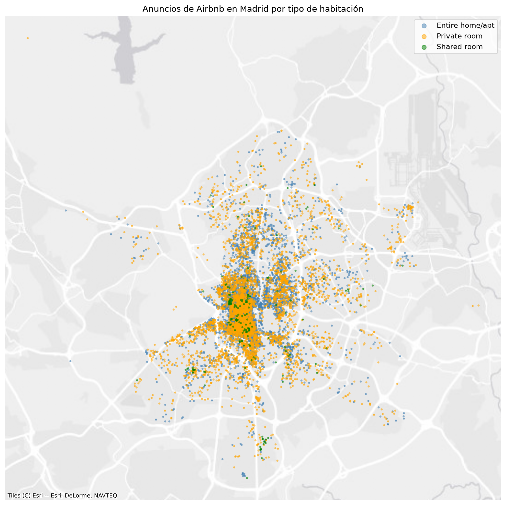

# Actividad 1 – Clasificación del tipo de alojamiento (Airbnb Madrid)

Práctica del módulo 1 de *Aprendizaje Automático I* (Máster). Se construye un modelo supervisado de **clasificación multiclase** que predice el tipo de alojamiento (`room_type`: *Entire home/apt*, *Private room*, *Shared room*) a partir del resto de características de cada anuncio.

## Datos

`airbnb.csv`: 13 321 anuncios de Airbnb en Madrid (abril de 2017), con 11 variables (barrio, coordenadas, precio, noches mínimas, número de reseñas, disponibilidad, etc.) y sin valores nulos.



## Qué se hace

1. **Análisis exploratorio**: distribución de variables, mapa de anuncios por tipo, correlaciones y relaciones entre variables.
2. **Preparación de datos**: división train/test, codificación *One-Hot* de las variables categóricas, transformación de variables numéricas asimétricas y escalado, todo dentro de un `Pipeline`.
3. **Modelos**: Naive Bayes, K-Nearest Neighbors y Árbol de decisión, comparados con un clasificador aleatorio de referencia mediante validación cruzada.
4. **Afinación de hiperparámetros** de KNN y del árbol con `GridSearchCV`.
5. **Evaluación en test** con accuracy, balanced accuracy y matriz de confusión.

## Ejecución

```powershell
python -m venv .venv
.venv\Scripts\activate
pip install -r requirements.txt
```

Después abre `Practica_1.ipynb` con VS Code o Jupyter.
